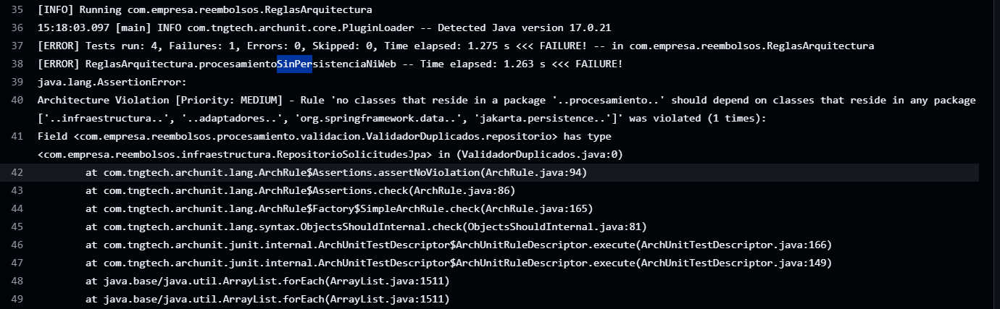
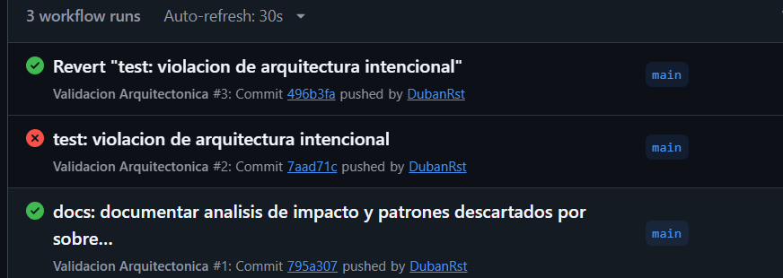

# Reembolsos Integrado - Proyecto integrador de patrones y arquitectura

## Descripción

Repositorio del proyecto integrador (Unidad 12) de Patrones de Diseño de Software: un sistema Spring Boot para las solicitudes de reembolso de gastos corporativos del área de Finanzas. La Parte 1 identifica la variabilidad de los requisitos y la resuelve con patrones; la Parte 2 evalúa la arquitectura, la protege con ArchUnit y documenta lo que se descartó por sobreingeniería.

## Diseño Propuesto

Esta sección se escribió antes de implementar cualquier patrón, a partir de la especificación del sistema y aplicando el test de explicabilidad de la Guía (si no se puede justificar un patrón en una oración, probablemente no se necesita).

| Requisito | Qué varía | Patrón propuesto | Justificación |
|-----------|-----------|------------------|---------------|
| RF1: validación en varias etapas | El conjunto y el orden de las verificaciones previas a la aprobación, que además crecerá (por ejemplo, un límite anual acumulado). | Chain of Responsibility | Se usa una cadena y no un único método con tres `if` porque cada verificación es independiente, se ejecuta en orden y corta en el primer rechazo, y agregar una cuarta debe consistir en enchufar un eslabón nuevo sin tocar los existentes. |
| RF2: cálculo distinto por categoría | La fórmula del monto aprobado, propia de cada categoría y con categorías nuevas previstas (por ejemplo, bienestar). | Strategy | Se usa Strategy y no un `switch` sobre la categoría porque cada categoría es un algoritmo intercambiable elegido por un único dato, y las categorías futuras deben añadirse como clases nuevas sin editar las fórmulas vigentes. |
| RF3: notificación simultánea | Qué partes reaccionan a un cambio de estado y qué hace cada una; el número de interesados crecerá (panel de métricas). | Observer | Se usa Observer y no llamadas directas del servicio a cada área porque un cambio de estado debe llegar a un conjunto creciente de interesados con reacciones distintas sin que el servicio conozca a ninguno: el panel de métricas será un suscriptor más. |


## Decisiones de diseño

### Decisión 1: orden de la cadena de validadores

Los validadores se encadenan en este orden: documentos soporte, monto máximo y duplicados. El criterio es el costo de ejecución. `ValidadorDocumentosSoporte` y `ValidadorMontoMaximo` son comprobaciones de un solo campo, de costo constante, mientras que `ValidadorDuplicados` recorre la lista de solicitudes pendientes del empleado. Como la cadena se corta en el primer rechazo, dejar el eslabón caro al final garantiza que solo se ejecuta cuando la solicitud ya superó las verificaciones baratas: las solicitudes obviamente inválidas (sin documentos o con un monto fuera de tope) nunca pagan la comparación. Lo que se pierde es que, si una solicitud tiene varios problemas, el empleado solo ve el primero y puede descubrir el duplicado después de corregir los otros dos; ordenar por costo prioriza la eficiencia sobre la experiencia de corregir todo en una sola pasada. Con el duplicado primero ocurriría lo contrario: se pagaría siempre la comparación, incluso para solicitudes que serían rechazadas por documentos. Una limitación reconocida del diseño actual es que el servicio carga la lista de pendientes antes de iniciar la cadena, de modo que el orden evita la comparación pero no esa consulta; si el volumen lo justificara, la lista se pasaría como un `Supplier` para cargarla solo cuando el eslabón la necesite.

### Decisión 2: mecanismo de selección de la calculadora

`SelectorCalculadora` recibe del contenedor de Spring una `List<CalculadoraReembolso>` con todos los `@Component` registrados y construye un mapa por categoría, en lugar de un método con un `switch` sobre `CategoriaGasto`. El RF2 exige agregar categorías nuevas (por ejemplo, bienestar) sin modificar las fórmulas existentes: con el mapa basta crear una clase que implemente `CalculadoraReembolso` y anotarla con `@Component`, y ninguna línea ya escrita se toca; con el `switch` habría que editar el método cada vez, con el riesgo de romper las ramas vigentes o de olvidar la nueva. El mapa añade dos garantías: si dos calculadoras declaran la misma categoría, el arranque falla al construirlo (clave duplicada), y una categoría sin calculadora produce un error explícito en lugar de un caso silencioso. Límite conocido: agregar una categoría también exige registrar su tope en `ValidadorMontoMaximo`, que mantiene su propio mapa; se acepta hoy porque son solo tres categorías (YAGNI) y se reconsideraría si la lista creciera o los topes cambiaran con frecuencia.


## Arquitectura resultante

```
com.empresa.reembolsos
├── dominio/             Modelo de la solicitud (SolicitudReembolso, CategoriaGasto, EstadoSolicitud)
├── procesamiento/       Reglas de negocio y patrones; no depende de infraestructura, adaptadores, Spring Data ni JPA
│   ├── validacion/      Chain of Responsibility: documentos, monto máximo y duplicados
│   ├── calculo/         Strategy: una calculadora por categoría (SelectorCalculadora, un nivel arriba)
│   └── notificacion/    Observer: empleado, contabilidad y auditoría
├── aplicacion/          SolicitudReembolsoService: único punto que coordina los tres patrones y el repositorio
├── infraestructura/     RepositorioSolicitudesJpa (Spring Data JPA)
└── adaptadores/rest/    Controlador REST y manejador de errores; solo hablan con aplicacion y dominio
```

Las reglas `ReglasArquitectura` (ArchUnit) verifican estos límites en cada push.

## Evidencia del pipeline

Para probar que las reglas realmente protegen la arquitectura, se introdujo una violación intencional de la Regla 1 (un campo `RepositorioSolicitudesJpa` dentro de `ValidadorDuplicados`), se subió y se revirtió.

Run en rojo: el job `arquitectura` falla por la violación de `procesamientoSinPersistenciaNiWeb`:



Historial de runs: verde, rojo por la violación y verde tras el revert:



## Cómo ejecutar

```powershell
mvn clean verify
mvn spring-boot:run
mvn test "-Dtest=ReglasArquitectura"
```

## Herramientas utilizadas

- Java 17, Spring Boot 3.3 (Web, Data JPA, H2), Apache Maven, JUnit 5, ArchUnit
- GitHub Actions, VS Code, Git, GitHub

## Conclusiones

Este proyecto mostró que elegir un patrón empieza por identificar qué varía en cada requisito: la cadena de validación, la estrategia de cálculo y los observadores resolvieron problemas distintos, y la justificación escrita antes del código obligó a precisar por qué cada uno y no otro. La Parte 2 enseñó a decidir también en el sentido contrario: no introducir un puerto de persistencia sin un caso real fue una decisión de arquitectura tan válida como introducirlo, y el ADR deja constancia de su costo. Las reglas de ArchUnit y la violación intencional convirtieron esas decisiones en límites que el pipeline hace cumplir, y el análisis de lo descartado dejó claro que un patrón sofisticado sin una variabilidad real detrás es deuda, no diseño.
